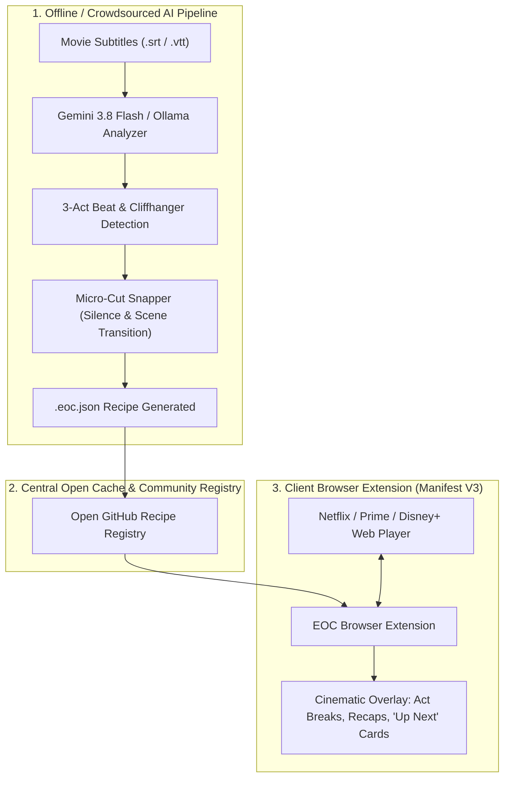

# Episodify Open Cut (`episodify-open-cut`)

[](https://www.gnu.org/licenses/agpl-3.0)
[](https://www.python.org/downloads/)
[](#zero-drm-compliance)
[](https://ai.google.dev/)

> **The Open-Source Engine That Transforms 3-Hour Movies into Bingeable Miniseries.**

---

## 1. Executive Summary

**Episodify Open Cut (EOC)** is an open-source AI narrative engine and client-side browser extension designed to eliminate **"Movie Commitment Paralysis"**.

Streaming audiences frequently hesitate to commit to a 2.5-hour film on a weeknight, yet regularly binge three consecutive 40-minute episodes of television. Conversely, modern streaming series suffer from bloat and filler, whereas feature films represent tightly written, high-budget cinematic masterclasses.

**Episodify Open Cut** bridges this gap:
* **Analyzes narrative beats** using classical screenplay structure and long-context multimodal AI (*Gemini 3.8 Flash*, local *Ollama*, or deterministic heuristics).
* **Slices feature films into 25–45 minute bingeable episodes** at organic act breaks and cliffhangers.
* **Micro-snaps cuts** to dialogue silences ($\ge 3.0\text{s}$ lull) with active subtitle and speech guards so characters are never cut off mid-dialogue.
* **Seamlessly pauses and overlays native OTT players** (Hotstar, Netflix, Prime Video, YouTube) via an open metadata overlay protocol without touching, decrypting, or re-hosting copyrighted video streams.

---

## ⚡ Quick Start in 3 Steps (Chrome / Brave / Edge)

No Python setup or coding required to start watching:

1. **Download / Clone this repository**:
   ```bash
   git clone https://github.com/shrish3397/episodify-open-cut.git
   ```
   *(Or click **Code ➔ Download ZIP** at the top right of this page and unzip it).*

2. **Load into your browser**:
   - Open `chrome://extensions/` (or `brave://extensions/`, `edge://extensions/`).
   - Enable **Developer Mode** (toggle in the top-right corner).
   - Click **Load unpacked** and select the [`extension/`](extension/) directory from this repository.
   - Pin the **Episodify Open Cut** extension icon to your toolbar.

3. **Open Hotstar, Netflix, or Prime Video and enjoy!**
   - Play any supported movie (like *Queen*, *Laapataa Ladies*, *2 States*, *We're the Millers*, or *The Batman*).
   - Episodify automatically detects the film, operates in silent standby until an act break arrives, and pauses cleanly between scenes with television-style Cliffhangers, Recaps, and *"Play Next Part"* cards!

### 🤖 Slicing ANY New / Uncataloged Movie with In-Browser Gemini AI (Zero-Terminal)
Want to episodify an uncataloged movie on Netflix, Prime Video, Hotstar, or YouTube?
1. Open and play the movie on your streaming tab.
2. Click the **Episodify** extension icon in your browser toolbar.
3. Click **🤖 Episodify with Gemini AI** in the popup footer.
4. Paste your free Google Gemini API key (get one in 10 seconds at [Google AI Studio](https://aistudio.google.com/app/apikey)) — saved securely in your local browser storage.
5. Select your desired episode count (3 to 6 episodes) and click **⚡ Slice Movie with Gemini AI**.
6. Gemini analyzes the screenplay narrative structure, dialogue transitions, and dramatic cliffhangers, instantly transforming your movie into a miniseries playing right in your browser!
7. *(Optional)* Click **📤 Publish Cut to Registry** to share your new cut with the global Episodify community via a 1-click GitHub Pull Request.

---

## 2. Core Problem & Market Opportunity

```
+------------------------------------+------------------------------------+
| The Movie Problem                  | The Series Problem                 |
+------------------------------------+------------------------------------+
| * 2.5 to 3.5 hour intimidating runtime| * Padded with filler episodes      |
| * Hard to fit into weekday evenings| * Plotlines dragged out over seasons|
| * No natural pause markers          | * Frequently cancelled mid-story   |
| * Scrubber bar gives zero context   | * Lower per-minute budget/quality  |
+------------------------------------+------------------------------------+
                                     |
                                     v
                       [ The Sweet Spot: EOC ]
   Prestige, completed cinema consumed with episodic convenience.
```

* **Loss of DVD Chapters:** When streaming replaced physical media, chapter navigation vanished. Viewers were left with an intimidating 180-minute progress bar.
* **Zero Direct Competition:** Traditional streaming extensions either skip intros or set manual bookmarks. No existing tool uses narrative AI to restructure movies into episodic miniseries seasons.

---

## 3. System Architecture & Zero-DRM Compliance

Because OTT streaming platforms encrypt video with Widevine/FairPlay DRM, **EOC operates strictly as a zero-copyright metadata overlay protocol** (the *SponsorBlock* model).



---

## 4. The `.eoc.json` Specification

An EOC recipe is a lightweight, human-readable JSON document specifying narrative boundaries and episodic title cards:

```json
{
  "$schema": "https://episodify.org/schema/v1.json",
  "meta": {
    "title": "Bethlehem Kudumba Unit",
    "year": 2026,
    "runtime_seconds": 9360,
    "imdb_id": "tt31846512",
    "pacing": "comedy"
  },
  "total_episodes": 4,
  "episodes": [
    {
      "episode_number": 1,
      "title": "The Angamaly Shift",
      "start_time": "00:00:00",
      "end_time": "00:39:15",
      "cliffhanger_rating": 8.4,
      "break_rationale": "Concludes as Ashley attends her first Bethlehem Kudumba Unit prayer gathering in Angamaly, where her unexpected musical connection with Justin first ignites neighborhood curiosity.",
      "recap_text": "Following financial distress in Mundakkayam, Ashley and her family relocate to Angamaly. While adjusting to the unfamiliar neighborhood, she crosses paths with Justin, the charismatic church choir and music coordinator.",
      "teaser_next": "Secret late-night choir rehearsals and impromptu scooter rides spark suspicions among the watchful Kudumba Unit elders."
    },
    {
      "episode_number": 2,
      "title": "Rhythms & Rumors",
      "start_time": "00:39:15",
      "end_time": "01:18:40",
      "cliffhanger_rating": 9.1,
      "break_rationale": "Justin confesses his genuine feelings to Ashley on the eve of the parish feast, just as neighborhood gossip threatens to expose their secret romance to her conservative family.",
      "recap_text": "Bonding over their shared love for music, Ashley and Justin's secret romance blossoms despite their contrasting backgrounds, navigating humorous neighbor encounters and community choir practice.",
      "teaser_next": "An unexpected letter of admission and student visa for Ireland arrives, threatening to tear Ashley and Justin apart."
    }
  ]
}
```

---

## 5. Installation & Quick Start

### 1. Python Core Engine (`eoc-core`)

Clone the repository and install locally:

```bash
git clone https://github.com/shrish3397/episodify-open-cut.git
cd episodify-open-cut

# Install in editable mode
python3 -m pip install -e .
```

To run with optional Gemini AI integration:
```bash
python3 -m pip install -e ".[ai,validation,dev]"
```

---

## 6. CLI Usage Guide

### Slicing a Movie Subtitle File (`eoc cut`)

Generate a miniseries recipe from any `.srt` or `.vtt` subtitle file:

```bash
# Using offline heuristic engine (zero external keys needed):
eoc cut movie.srt --title "Bethlehem Kudumba Unit" --year 2026 --runtime 9360

# Using Google Gemini 3.8 Flash:
export GEMINI_API_KEY="your-api-key"
eoc cut movie.srt --title "Bethlehem Kudumba Unit" --year 2026 --provider gemini

# Using local Ollama:
eoc cut movie.srt --title "The Batman" --year 2022 --provider ollama
```

### Inspecting a Recipe (`eoc info`)

Displays an ASCII cinematic summary table:

```bash
eoc info recipes/bethlehem-kudumba-unit-2026.eoc.json
```

```
======================================================================
📽️  BETHLEHEM KUDUMBA UNIT (2026)
⏱️  Runtime: 156 mins (9360s) | Pacing: comedy
🍿 IMDb: tt31846512 | Generator: eoc-core
======================================================================

Episode 1: The Angamaly Shift
  Time: 00:00:00 ➔ 00:39:15 (39m 15s)
  Cliffhanger Rating: 8.4/10 ★★★★
  Break Rationale: Concludes as Ashley attends her first Bethlehem Kudumba Unit prayer gathering.
  Recap: Following financial distress in Mundakkayam, Ashley and her family relocate to Angamaly.
  Teaser: Secret late-night choir rehearsals and impromptu scooter rides spark suspicions.
...
```

### Validating a Recipe (`eoc validate`)

Verifies compliance against `schema/v1.json` and enforces continuous narrative continuity:

```bash
eoc validate recipes/bethlehem-kudumba-unit-2026.eoc.json
```

### Testing Micro-Cut Snapper (`eoc snap`)

Finds the nearest dialogue silence lull around any timestamp:

```bash
eoc snap movie.srt --time 00:39:00
```

### Exporting Chapters for Local Video Players (`eoc export`)

Export recipes to standard chapter formats:

```bash
# Export FFmpeg metadata (embed with ffmpeg -i movie.mp4 -i chapters.txt -map_metadata 1 -codec copy out.mp4)
eoc export recipes/bethlehem-kudumba-unit-2026.eoc.json --format ffmpeg

# Export Matroska / MKVToolNix XML chapters
eoc export recipes/bethlehem-kudumba-unit-2026.eoc.json --format mkv

# Export SRT chapter title-cards
eoc export recipes/bethlehem-kudumba-unit-2026.eoc.json --format srt
```

---

## 7. Browser Extension Setup

The browser extension works in Chrome, Brave, Edge, and any Chromium-compatible browser:

1. Open your browser and navigate to `chrome://extensions/`.
2. Toggle on **Developer mode** in the top right corner.
3. Click **Load unpacked** and select the `extension/` directory from this repository.
4. Pin the **Episodify Open Cut** extension icon to your toolbar.

### Interactive Demo Player

Test the in-player modal and act break triggers without needing an active OTT subscription:
* Open `extension/demo/player.html` directly in your browser.
* Click **Fast Forward to 5s before Break 1** or let the video reach the break boundary to see the cinematic overlay trigger in real-time.

---

## 8. Open Recipe Registry

The `recipes/` directory provides pre-analyzed, validated miniseries cuts for iconic films:

| Film | Year | Platform | Episodes | Recipe File |
| :--- | :--- | :--- | :--- | :--- |
| **Queen** | 2014 | Prime Video | 4 | [`recipes/queen-2014.eoc.json`](recipes/queen-2014.eoc.json) |
| **Laapataa Ladies** | 2024 | Netflix | 4 | [`recipes/laapataa-ladies-2024.eoc.json`](recipes/laapataa-ladies-2024.eoc.json) |
| **2 States** | 2014 | Hotstar | 4 | [`recipes/2-states-2014.eoc.json`](recipes/2-states-2014.eoc.json) |
| **We're the Millers** | 2013 | Netflix | 4 | [`recipes/were-the-millers-2013.eoc.json`](recipes/were-the-millers-2013.eoc.json) |
| **Khoobsurat** | 2014 | Prime / Netflix | 4 | [`recipes/khoobsurat-2014.eoc.json`](recipes/khoobsurat-2014.eoc.json) |
| **Sarvam Maya** | 2026 | Hotstar | 6 | [`recipes/sarvam-maya-2026.eoc.json`](recipes/sarvam-maya-2026.eoc.json) |
| **Bethlehem Kudumba Unit** | 2026 | Hotstar | 4 / 6 / 8 | [`recipes/bethlehem-kudumba-unit-2026.eoc.json`](recipes/bethlehem-kudumba-unit-2026.eoc.json) |
| **The Batman** | 2022 | HBO / Prime | 4 | [`recipes/the-batman-2022.eoc.json`](recipes/the-batman-2022.eoc.json) |
| **Dune: Part Two** | 2024 | Max / Prime | 4 | [`recipes/dune-part-two-2024.eoc.json`](recipes/dune-part-two-2024.eoc.json) |
| **Avengers: Endgame** | 2019 | Disney+ | 4 | [`recipes/avengers-endgame-2019.eoc.json`](recipes/avengers-endgame-2019.eoc.json) |
| **The Godfather** | 1972 | Paramount+ | 4 | [`recipes/the-godfather-1972.eoc.json`](recipes/the-godfather-1972.eoc.json) |
| **Oppenheimer** | 2023 | Prime / Peacock | 4 | [`recipes/oppenheimer-2023.eoc.json`](recipes/oppenheimer-2023.eoc.json) |

---

## 9. Testing & Quality Assurance

Run the comprehensive unit and integration test suite:

```bash
python3 -m unittest discover tests
```

---

## 10. License

This project is licensed under the **GNU Affero General Public License v3.0 (AGPL-3.0)**. See the [LICENSE](LICENSE) file for complete details.
